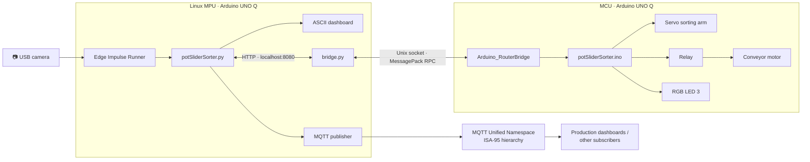

# 🏭 Conveyor Line Object Detection and Sorter

**Edge Impulse + Arduino UNO Q**  
Roni Bandini — November 2026

A compact conveyor-line sorting system using Edge Impulse object detection, an Arduino UNO Q, a servo-driven sorting arm and an MQTT Unified Namespace.

---

## ✨ Features

- 📷 USB camera captures objects moving along a conveyor
- 🧠 Edge Impulse detects two plastic control caps: **POT** and **SLIDER**
- ⚡ Linux MPU runs inference and Python; the MCU handles hardware control
- ↔️ Servo arm directs objects toward their corresponding sorting lanes
- 📦 Independent POT and SLIDER counters and box-capacity limits
- ⏱️ Three-second final-item transit window before stopping a full line
- 🔴 Flashing RGB indicator and operator acknowledgement when a category reaches capacity
- 🖥️ ASCII dashboard with production totals and capacity bars
- 🌐 MQTT UNS publishes equipment state and production events using an ISA-95 hierarchy
- 🌉 Python checks the local bridge and starts it automatically when needed

---

## 🏗️ Architecture



The UNO Q combines a Linux MPU and a microcontroller. The MPU runs Edge Impulse Runner, Python, the dashboard and MQTT publishing. The MCU controls the servo, relay and RGB LED. `bridge.py` translates local HTTP requests into MessagePack RPC calls through `/var/run/arduino-router.sock`, following the communication pattern used in [Jaime](https://github.com/ronibandini/Jaime).

---

## 📁 Repository Structure

```text
.
├── potSliderSorter.py     # MPU application: inference, counters, dashboard and MQTT
├── potSliderSorter.ino    # MCU firmware: servo, relay, RGB LED and box state
├── bridge.py              # HTTP ↔ Arduino Router / MessagePack RPC bridge
├── conveyor-line-classification-linux-aarch64-v8-impulse-#1.eim
├── LICENSE
└── README.md
```

---

## 🚀 Getting Started

### Hardware

| Component | Purpose |
|---|---|
| Arduino UNO Q | Linux MPU and MCU controller |
| USB webcam | Conveyor image capture |
| SG90 servo | Sorting arm |
| 1-channel relay | Conveyor control |
| Motorized conveyor | Object transport |
| USB hub | Camera and peripheral connection |

| UNO Q connection | Component |
|---|---|
| D5 | Servo signal |
| D7 | Relay control |
| USB | Camera |
| Onboard RGB LED 3 | Detection and box status |

The model labels refer to the **plastic caps** fitted over a rotary potentiometer and a linear slider control, not the complete components.

### 1. Upload the MCU firmware

Open `potSliderSorter.ino` in Arduino App Lab, select the UNO Q and upload the sketch. It uses `Servo.h` (the same Servo library implementation used by [Jaime](https://github.com/ronibandini/Jaime)) and `Arduino_RouterBridge`.

### 2. Install Linux dependencies

On the UNO Q:

```bash
sudo apt update
sudo apt install python3-msgpack python3-paho-mqtt
```

Install and configure Edge Impulse Linux Runner. Complete its initial login and model selection once, then exit the interactive setup. The project model is also available through [Edge Impulse Studio](https://studio.edgeimpulse.com/public/1156140/live).

An MQTT broker must be reachable at the address configured in `potSliderSorter.py`. For a local Mosquitto broker:

```bash
sudo apt install mosquitto mosquitto-clients
sudo systemctl enable --now mosquitto
```

### 3. Run

Keep `potSliderSorter.py` and `bridge.py` in the same directory. Start the application:

```bash
python3 potSliderSorter.py
```

The main application checks the HTTP bridge and starts `bridge.py` in the background if it is not already running. If the Arduino Router socket requires elevated permissions, it requests sudo authentication. Bridge output is written to `bridge.log`. Do not start a second bridge on port `8080`.

---

## ⚙️ How It Works

### Startup and detection

The MCU initializes with the conveyor stopped. Python launches Edge Impulse Runner and waits for the first valid inference frame before authorizing the conveyor to start. The parser reads Edge Impulse `boundingBoxes` output and applies the configured confidence threshold.

- **POT:** servo moves toward the POT sorting lane; POT counter increments.
- **SLIDER:** servo moves toward the SLIDER sorting lane; SLIDER counter increments.
- **No detection:** RGB indicator returns to green.

The servo starts at its middle position. Five seconds after each accepted detection or new-box acknowledgement, the MCU returns it to the middle using a non-blocking `millis()` timer. Bridge requests can continue while the servo timer is active.

### Duplicate suppression

After an object is registered, Python blocks additional registrations during a configurable three-second window. It also requires three consecutive frames without a recognized object before rearming. Both conditions must be satisfied before another object can be counted.

### Independent box capacity

POT and SLIDER have separate in-box counters and capacity limits. The default is two units per category. Reaching either category's limit fills that category's box and stops the conveyor after the final-item transit delay.

1. Further object registrations are locked.
2. The conveyor continues for three seconds so the final item can reach the box.
3. The MCU stops the conveyor and flashes RGB LED 3 red.
4. The dashboard waits for the operator.
5. After replacing the full box, press **N** or **ENTER** in the Python terminal. The box number increments, both category counters reset, and the conveyor resumes if inference is ready.

The dashboard displays separate POT and SLIDER capacity bars and session totals.

---

## 🔧 Configuration

Application settings are defined near the top of `potSliderSorter.py`. Edit the file directly; application settings do not use OS environment variables.

| Setting | Default | Description |
|---|---:|---|
| `classificationThreshold` | `0.80` | Minimum detection confidence |
| `duplicateSuppressionSeconds` | `3.0` | Duplicate suppression window |
| `rearmMissFrames` | `3` | Consecutive absent frames required to rearm |
| `boxLimitPerCategory` | `2` | Default capacity assigned to each category |
| `potBoxLimit` | `2` | POT capacity for the active box |
| `sliderBoxLimit` | `2` | SLIDER capacity for the active box |
| `boxFullStopDelaySeconds` | `3.0` | Final-item transit delay; must match the MCU sketch |
| `mqttHost` / `mqttPort` | `127.0.0.1` / `1883` | MQTT broker address and port |

MQTT credentials, client ID and ISA-95 identifiers (`enterprise`, `site`, `area`, `line`, `cell`, `equipment`) are also configured in the Python file.

Hardware and timing settings are in `potSliderSorter.ino`:

| MCU setting | Default |
|---|---:|
| Servo middle/start | 90° |
| SLIDER position | 45° |
| POT position | 130° |
| Servo return delay | 5,000 ms |
| Final-item transit delay | 3,000 ms |
| Relay LOW | Conveyor running |
| Relay HIGH | Conveyor stopped |

Keep the Python and MCU transit-delay settings aligned.

---

## 🌐 MQTT Unified Namespace (UNS)

The sorter publishes to an ISA-95-style hierarchy:

```text
enterprise/site/area/line/cell/equipment
```

Default topic root:

```text
demo-enterprise/site-01/area-01/line-01/cell-01/uno-q-pot-slider-sorter
```

| Topic | Content |
|---|---|
| `.../state` | Retained equipment, inference and production snapshot |
| `.../availability` | Online/offline state and MQTT Last Will and Testament |
| `.../events/detection` | Detected label and confidence |
| `.../events/object` | Accepted POT or SLIDER object |
| `.../events/sorter` | Conveyor and sorter state changes |
| `.../events/box` | Category capacity, transit, box completion and replacement |

State snapshots are retained; event messages use QoS 1. MQTT is the messaging transport. The UNS is the shared namespace that gives production data its enterprise, site, area, line, cell and equipment context. Other applications can subscribe without communicating directly with the conveyor controller.

Inspect messages from a local broker:

```bash
mosquitto_sub -h 127.0.0.1 -t 'demo-enterprise/#' -v
```

---

## 📟 Dashboard

The terminal displays current POT and SLIDER confidence, bridge and inference status, conveyor and servo state, RGB status, large session totals, independent capacity bars, box number, MQTT status and the latest event. Keep the terminal interactive to acknowledge a replacement box with **N** or **ENTER**.

---

## 📚 References

- [Edge Impulse model — Studio](https://studio.edgeimpulse.com/public/1156140/live)
- [Arduino UNO Q](https://docs.arduino.cc/hardware/uno-q/)
- [Arduino RouterBridge documentation](https://docs.arduino.cc/tutorials/uno-q/routerbridge-multilanguage/)
- [Jaime — Arduino UNO Q robot](https://github.com/ronibandini/Jaime)
- [MQTT](https://mqtt.org/)
- [ISA-95](https://www.isa.org/standards-and-publications/isa-standards/isa-95-standard)

## 📄 License

GPL-2.0 — see [LICENSE](LICENSE).

## 👤 Author

Roni Bandini — Buenos Aires, Argentina  
November 2026
